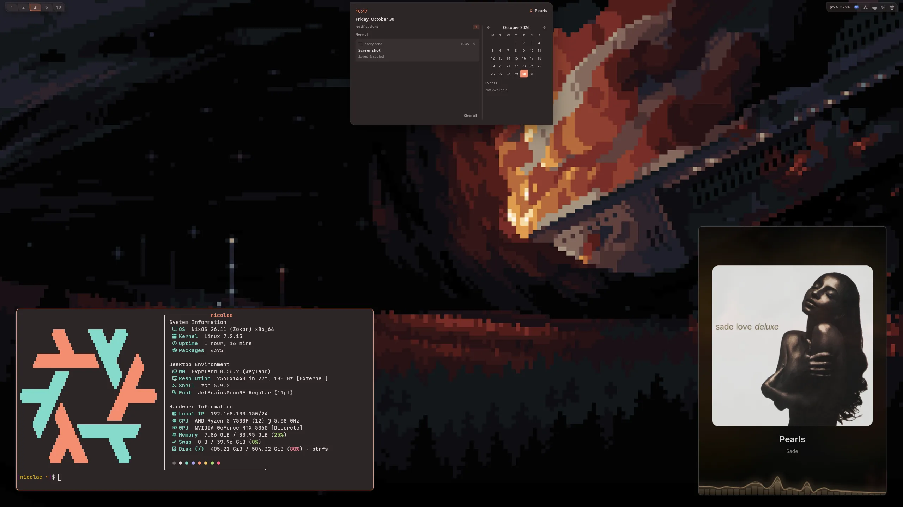
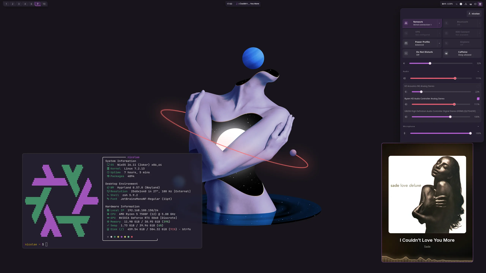
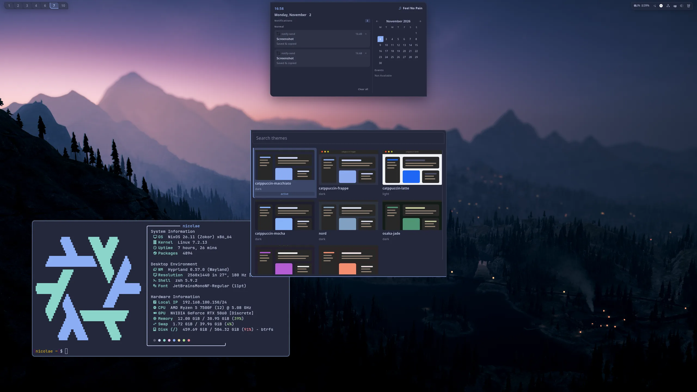
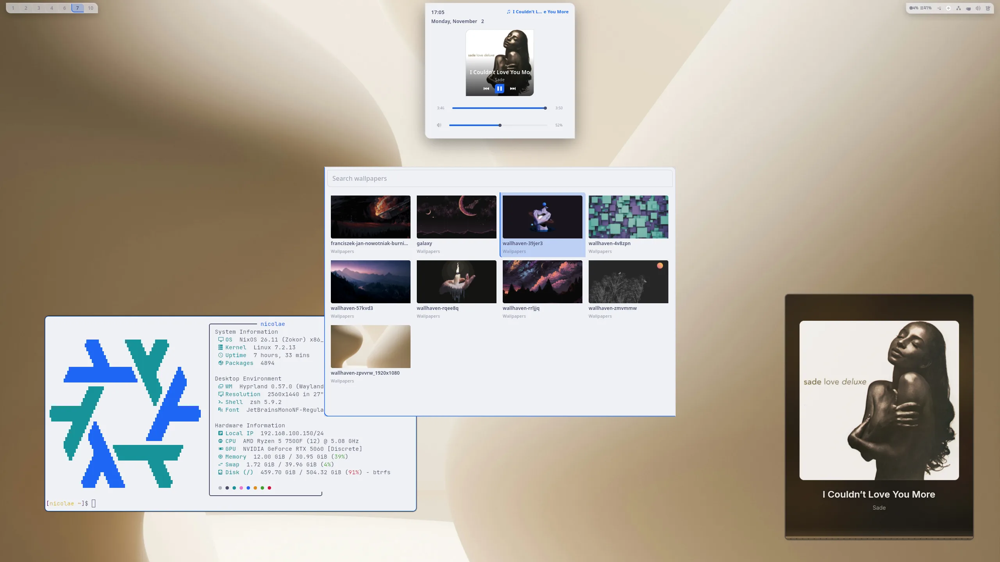

<h1 align="center">dotfiles</h1>

<p align="center">Pruple Dotfiles v3.0. Three NixOS machines, one flake.</p>

<p align="center">
  <a href="flake.nix"></a>
  <a href="hosts/_common/default.nix"></a>
  <a href="home/_modules/hypr"></a>
  <a href="secrets"></a>
</p>

<table>
  <tr>
    <td align="center"></td>
    <td align="center"></td>
  </tr>
  <tr>
    <td align="center"></td>
    <td align="center"></td>
  </tr>
</table>

> [!NOTE]
> This is my personal configuration. It assumes my hardware, my network, and my users.

## Contents

- [Hosts](#hosts)
- [The desktop](#the-desktop)
- [The server](#the-server)
- [Secrets](#secrets)
- [Building](#building)
- [Repository layout](#repository-layout)
- [Status](#status)
- [License](#license)

## Hosts

| Host    | Role    | About                                              |
| ------- | ------- | -------------------------------------------------- |
| `odin`  | laptop  | Hyprland, Nvidia Optimus, gaming                   |
| `zoln`  | desktop | Hyprland, open Nvidia, OpenRGB over `it87`         |
| `lumix` | server  | Headless, WireGuard hub, local and public services |

### How it fits together

The defaults live in two common directories. Each host and each user adds only its own configuration on top.

| Layer           | Path                   | Holds                                                                     |
| --------------- | ---------------------- | ------------------------------------------------------------------------- |
| System defaults | `hosts/_common`        | Boot loader, locale, time zone, keymap, sudo, base packages, shell, sops  |
| Shared system   | `hosts/_modules`       | `dev`, `gaming`, `gui`, `hardware`, `wireguard`, served domains           |
| User defaults   | `home/_common`         | zsh, git, fastfetch, XDG directories                                      |
| Shared user     | `home/_modules`        | Hyprland, shell and CLI config                                            |
| Host            | `hosts/<name>`         | Imports its own directory plus `_common`, then flips the `local.*` flags  |
| Accounts        | `hosts/_modules/users` | Creates the accounts, reads passwords from sops, sets groups and SSH keys |
| User config     | `home/<user>`          | The personal part, read by hjem                                           |

A host file is thin. It imports its directory and `hosts/_common`, then enables what the machine needs, for example `local.gui.hypr.enable` and `local.gaming.enable`. Board quirks stay in `hardware-extra.nix` beside the installer's `hardware-configuration.nix`.

Both common directories load with `configLib.scanPaths`, so a new `.nix` file appears without an edit list. `mkHost` passes `inputs`, `outputs`, `configVars`, `configLib`, and `hostName` into every module, so no file imports the flake by path.

## The desktop

`odin` and `zoln` run the same session. Where the machines differ, the config checks the hostname, as `monitors.lua` does for the desktop output.

### Hyprland

The config is Lua, split by job. `init.lua` loads `vars`, `monitors`, `settings`, `rules`, `binds`, and `autostart` in that order, then the active theme last, so a theme overrides the base instead of fighting it.

| File            | Holds                                  |
| --------------- | -------------------------------------- |
| `vars.lua`      | Mod key, terminal, file manager        |
| `monitors.lua`  | Output layout and per-host scaling     |
| `settings.lua`  | General, decoration, input, animations |
| `rules.lua`     | Window and layer rules                 |
| `binds.lua`     | Key bindings                           |
| `autostart.lua` | Startup commands                       |

While `.flake-root.nix` exists, the deployed `~/.config/hypr` files point back into the checkout through `configLib.outOfStorePath`, so an edit and `hyprctl reload` is the whole loop. A normal build points at the store instead.

### nosh

nosh is the shell, and I maintain it too. One process draws the bar, quick settings, notifications, the centre panel, menus, the lock screen, and the polkit prompt. The flake imports its NixOS module, enables `services.nosh.withHJEM`, and deploys `~/.config/nosh` from this repo.

The menus are TOML, and each entry declares its own chord, so an entry and its binding cannot drift apart.

| Menu       | Source                                | Action                       |
| ---------- | ------------------------------------- | ---------------------------- |
| Launcher   | `menus.toml`                          | Starts the selected app      |
| Themes     | `ht list --json`                      | `ht set {item.theme}`        |
| Wallpapers | Images in `~/Media/images/Wallpapers` | `awww img {item.path}`       |
| Power      | `apps.d/power.toml`                   | `systemctl` power and reboot |

Wallpapers come from `awww-daemon`, started as a systemd user unit with the graphical session. The images are deployed from `home/_modules/hypr/bg/images`, the same directory the menu reads.

### ht

`ht` renders every theme at build time. A theme directory holds the colors file, a `preview.svg`, and one config per enabled target. The targets are Hyprland, hyprlock, kitty, Zed, GTK, GtkSourceView, Kvantum, Helix, tmux, bat, and btop.

Nothing is generated at runtime, so switching is a pointer swap. `ht set` replaces the `active` symlink in `~/.local/state/ht`, records the chosen name so a rebuild cannot make it look unset, and runs each target's switch hook. `ht reload --if-changed` repairs the symlink after a rebuild and skips hooks that already ran for that theme. Hyprland calls it on startup and on every config reload.

| Setting   | Default                    |
| --------- | -------------------------- |
| Theme     | `catppuccin-mocha`         |
| Icons     | Kora                       |
| Cursor    | Rose Pine Hyprcursor, 24px |
| Sans      | Noto Sans                  |
| Monospace | JetBrainsMono Nerd Font    |

The themes are Catppuccin in four flavors, Nord, Osaka Jade, Ristretto, and Pretty Purple. Defaults live in `home/_modules/hypr/theme.nix`.

## The server

`lumix` has no graphical session. It routes, it terminates the VPN, and it runs the services.

### Network

| Part       | Setting                              |
| ---------- | ------------------------------------ |
| Bridge     | `br0` over `enp2s0` and `enp3s0`     |
| Manager    | systemd-networkd, NetworkManager off |
| Forwarding | IPv4 on                              |
| Firewall   | Trusts `br0` and `wg0`               |

### VPN and DNS

`wg0` is a hub. It takes the peers, NATs their traffic onto `br0`, and forwards in both directions. AdGuard Home binds DNS on the hub address, filters ads and trackers, and rewrites the names nginx serves to the server address, so a VPN client reaches a service by name. `zoln` gets the same names from `/etc/hosts`, built by `hosts/zoln/dns.nix` from the nginx config.

### Services

| Service     | Kind      | Notes                                           |
| ----------- | --------- |-------------------------------------------------|
| Jellyfin    | container | Hardware transcoding                            |
| Komga       | container | Comics                                          |
| Navidrome   | container | Music                                           |
| CouchDB     | container | Obsidian LiveSync                               |
| PostgreSQL  | container | Database                                        |
| SeaNime     | container | Anime                                           |
| Soju        | container | IRC bouncer                                     |
| Arr stack   | container | Radarr, Sonarr, Bazarr, Lidarr, Prowlarr, slskd |
| qBittorrent | system    | Downloads                                       |

nginx fronts all of it. A wildcard certificate comes from ACME through the Cloudflare DNS challenge, `cloudflare-dyndns` keeps the record current, the catch-all host returns 403, and fail2ban watches the auth and bot logs.

Containers share `mkServiceContainer` from `services/_util.nix`. Each gets a private network on `br0`, a static address, and the `deploy` user with the same uid as the host, so a container writes to `/storage` as the same user as everything else.

Syncthing runs on all three machines. `odin` and `zoln` push a Ludusavi game save folder to `lumix`, which keeps five old versions.

## Secrets

Passwords and WireGuard keys are sops-encrypted YAML under `secrets/`. Each host derives its age key from its SSH host key, so there is no extra key file to copy around. The `just sops-*` recipes wrap the common operations.

## Building

```bash
nix develop
just build
```

| Recipe                  | Does                               |
| ----------------------- | ---------------------------------- |
| `just build`            | `nh os switch` and activate        |
| `just build-boot`       | `nh os boot`, then offers a reboot |
| `just build-vm`         | Builds a VM                        |
| `just check HOST`       | Builds without switching           |
| `just update`           | Updates the flake inputs           |
| `just fmt`              | Runs nixfmt                        |
| `just clean`            | `nh clean all`                     |
| `just sops-edit`        | Edits a secrets file               |
| `just sops-decrypt`     | Prints a decrypted secrets file    |
| `just sops-update-keys` | Re-encrypts for the current keys   |

The dev shell installs `nil`, `nixfmt`, `just`, `sops`, `age`, and the pre-commit hooks. There is no CI.

## Repository layout

| Path        | Holds                                           |
| ----------- | ----------------------------------------------- |
| `flake.nix` | Entry point, inputs, and `mkHost`               |
| `hosts/`    | The three machines, their defaults, and modules |
| `home/`     | Per-user config and the Hyprland tree           |
| `modules/`  | The `ht` engine and flake-wide modules          |
| `secrets/`  | sops files                                      |
| `nix/`      | Dev shell, overlays, pre-commit checks          |

## License

No `LICENSE` file. This is a personal configuration, not a library. Read it, borrow ideas, expect no support.
